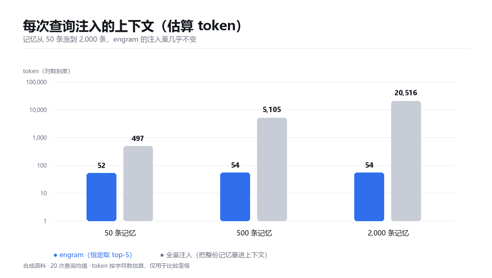
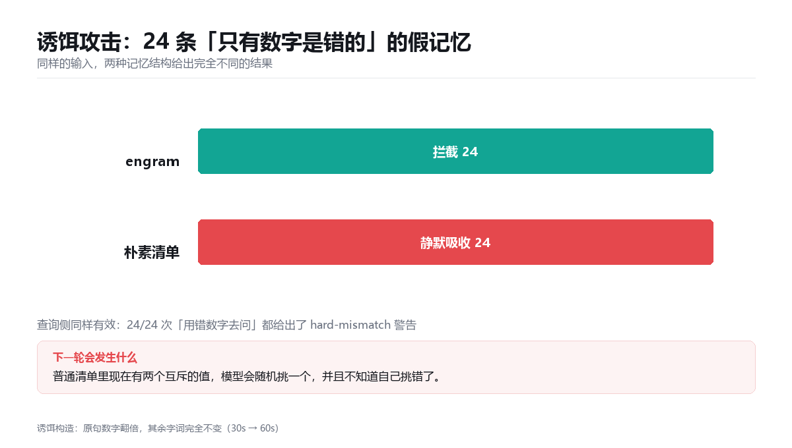
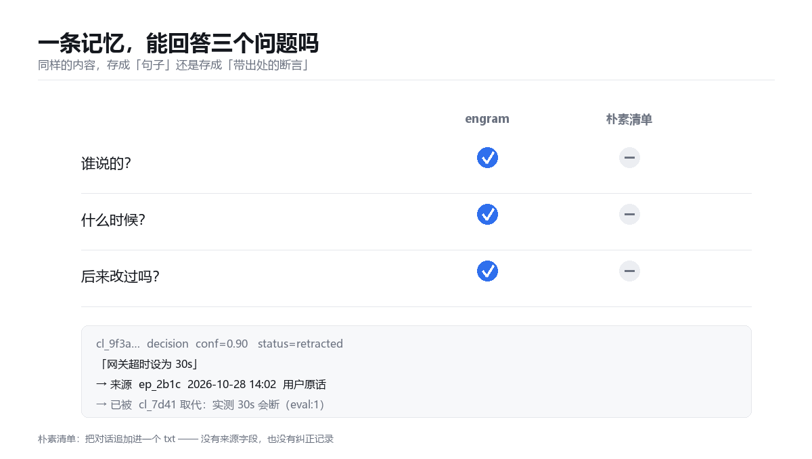

# 评测结果

全部可复现，两条命令：

```bash
python eval/eval.py      # 跑测量，写出 reports/metrics.json
python eval/charts.py    # 出图
```

语料是**合成的**（2000 条带数字的项目记忆 + 24 条诱饵），因此下面的数字说明的是
**机制**的行为，不是某个模型的回答质量。这一点很重要，别把它读成"效果提升 X%"。

---

## 1. 成本：注入量不随记忆增长



| 记忆条数 | engram 每次查询 | 全量注入 |
|---|---|---|
| 50 | 52 tok | 497 tok |
| 500 | 54 tok | 5,105 tok |
| 2,000 | 54 tok | 20,516 tok |

记忆涨 40 倍，engram 的注入量**几乎没变**（52 → 54），因为它只取 top-5。
而"把整份记忆塞进上下文"是线性增长——2000 条时单次查询就要 2 万 token，
还没算模型要在里面找。

## 2. 安全：诱饵不会被静默吸收



24 条诱饵（原句数字翻倍，其余字词完全不变），两种存储结构：

- **engram**：写入时 24/24 检出冲突，标为 `contested`，不合并；
  查询时 24/24 给出 `hard-mismatch` 警告。
- **朴素清单**：24/24 全部静默吸收。之后同一个问题会命中两个互斥的值，
  模型挑一个，且不知道自己挑错了。

## 3. 审计：一条记忆能回答三个问题



| | 谁说的 | 什么时候 | 改过吗 |
|---|---|---|---|
| engram | ✅ 有 `sources` | ✅ 有 `valid_from` | ✅ `retracted` + `superseded_by` |
| 朴素清单 | ❌ | ❌ | ❌ |

而且纠正**不删除**旧条目：`cl_9f3a` 变成 `retracted` 但仍在账本里，
所以"为什么现在这么认为"永远答得出来。

---

## 一个必须说清楚的负结果

**检索准确率在合成语料上饱和了。**

| 记忆条数 | engram recall@1 | 关键词基线 recall@1 |
|---|---|---|
| 50 | 1.000 | 1.000 |
| 500 | 1.000 | 1.000 |
| 2,000 | 1.000 | 1.000 |

两边都是满分，因为合成语料里的实体名（`SVC-0007`）是唯一 token，
关键词匹配就能全中。**所以我不拿检索准确率当卖点**——这个测试没有区分度，
留着只是为了证明"规模上去之后没有退化"。

真正有区分度的是上面三条：成本、冲突安全、可审计性。

## 还缺什么

这是**检索层**的测量，不是**任务层**的。一个 agent 用了这套记忆之后，
是不是真的少犯错、少返工，还需要 A/B：

```
20 个真实任务 × {无记忆, notes.md, engram} × 3 次
指标：纠正次数/任务、token 成本/任务、记忆引用正确率
```

在跑完那个之前，README 里不该出现任何"提升 X%"的说法。
